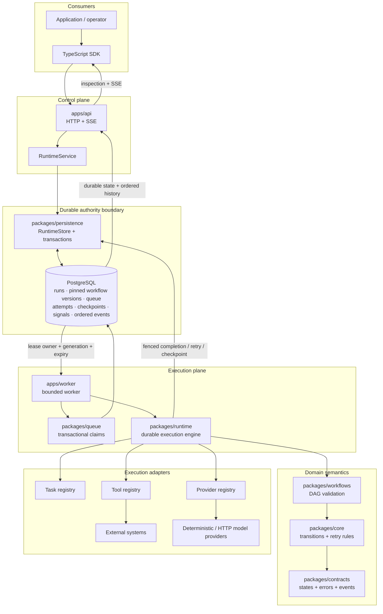

# AgentForge

**AgentForge is a durable TypeScript execution runtime for long-running agents and workflows.**

It is built around a simple operational requirement: work should survive process failure without losing execution authority, history, or recovery semantics. AgentForge persists workflow state in PostgreSQL, schedules DAG work through transactional claims, fences stale workers with lease generations, records ordered execution history, and exposes the runtime through HTTP/SSE and a TypeScript SDK.

AgentForge is not a visual workflow builder, a chat UI, a prompt-wrapper library, a generic message broker, or an exactly-once marketing claim. Its focus is durable execution semantics.

## What it provides

- durable workflow and run state in PostgreSQL;
- validated DAG execution with dependency scheduling;
- bounded workers with transactional claims and lease-generation fencing;
- append-only execution-attempt history;
- retries, timeouts, cancellation, checkpoints, waits and durable signals;
- task, tool and model-provider registries;
- deterministic provider support for offline tests and examples;
- explicit idempotency boundaries for side-effecting tools;
- ordered runtime events and SSE inspection;
- HTTP control plane and TypeScript SDK;
- deterministic unit tests plus real PostgreSQL integration tests;
- executable recovery examples, benchmark smoke tests and container validation.

## Architecture



PostgreSQL is both the durable source of truth and the queue substrate. Redis is intentionally not required. Claims use transactional row locking and lease generations; work may execute more than once over time, but only the current authoritative lease generation may commit completion.

See [architecture](docs/architecture.md), [execution model](docs/execution-model.md), [persistence](docs/persistence.md), and [state machines](docs/state-machines.md).

## Execution and authority model

AgentForge separates execution from authority:

1. A workflow definition is validated and persisted as a pinned workflow version.
2. Starting a run persists the run and its initially eligible work.
3. A worker transactionally claims work and receives a lease owner, generation and expiry.
4. The runtime executes the task, tool, model or agent step under bounded retry/timeout/cancellation rules.
5. Completion is accepted only when the lease authority is still current.
6. Durable state transitions schedule newly eligible downstream work and append ordered events.
7. Clients inspect current state and history through the API, SDK or SSE stream.

This model supports crash recovery while rejecting stale completions from superseded workers.

## Reliability semantics

- **At-least-once execution reality.** Retries and crash recovery can repeat execution attempts.
- **No arbitrary exactly-once external-effect claim.** Side-effecting tools receive stable operation keys, but the external system must honor an idempotency key when the effect itself must be deduplicated across a crash boundary.
- **Stale-worker fencing.** Lease owner + lease generation + unexpired lease form commit authority.
- **Append-only attempt history.** Retries create new durable attempts; previous failures remain inspectable.
- **Workflow version pinning.** A run retains the exact workflow version it started with.
- **Monotonic cancellation.** Cancellation prevents stale success from resurrecting cancelled work.
- **Durable wait/signal.** Waiting runs survive process replacement and resume after deduplicated signals.
- **Idempotent run submission.** `POST /v1/runs` accepts `Idempotency-Key`; same-key/same-request replay returns the original run, while conflicting reuse fails closed.

See [failure semantics](docs/failure-semantics.md), [idempotency](docs/idempotency.md), and [checkpoints](docs/checkpoints.md).

## Major subsystems

| Area | Responsibility |
| --- | --- |
| `packages/contracts` | Serializable states, identifiers, errors and events |
| `packages/core` | Pure state-transition and retry-policy rules |
| `packages/workflows` | Workflow validation, DAG semantics and dependency checks |
| `packages/runtime` | Worker execution, retries, timeouts, cancellation, checkpoints and agent/tool/provider dispatch |
| `packages/queue` | Transactional claim and lease SQL contracts |
| `packages/persistence` | PostgreSQL adapter, migrations and transaction boundaries |
| `packages/events` | Typed event source/sink interfaces and bounded event pumping |
| `packages/tools` | Tool registration and side-effect/idempotency policy |
| `packages/providers` | Deterministic and optional HTTP model-provider adapters |
| `packages/sdk` | HTTP/SSE client and workflow ergonomics |
| `apps/api` | HTTP/SSE control plane |
| `apps/worker` | Worker-process wiring |

The domain layer does not depend on HTTP or PostgreSQL. API routes delegate through runtime/store boundaries rather than mutating durable state directly.

## Tools, providers and external integrations

Registered tools are trusted host code selected by stable names. They execute with the operating-system privileges of the worker process; AgentForge does not sandbox tool code. Side-effecting tools use explicit operation-key semantics so callers can reason about crash boundaries.

`ModelProvider.invoke` is the model-runtime boundary. Tests and examples can use the local deterministic provider without an API key. An optional OpenAI-compatible HTTP adapter is available without making a vendor SDK part of the core runtime.

Event delivery is separated from durable execution history through `EventSource` / `EventSink` interfaces. See [event delivery](docs/event-delivery.md).

## Local development

Prerequisites:

- Node.js 22;
- Corepack and pnpm 10.18.3;
- TypeScript 5.8.3 (`tsc` on `PATH`);
- Docker/Compose;
- PostgreSQL client (`psql`).

No model-provider API key is required for the test suite or deterministic examples.

```bash
corepack enable
corepack prepare pnpm@10.18.3 --activate
npm install --global typescript@5.8.3
pnpm install --frozen-lockfile
pnpm dev:infra
pnpm db:migrate
pnpm dev
```

The local API uses `http://127.0.0.1:8787` unless `AGENTFORGE_API_PORT` is set.

Health and contract surfaces:

```text
GET /health/live   process liveness
GET /health/ready  PostgreSQL-backed readiness
GET /metrics       Prometheus text metrics
GET /openapi.json  runtime API contract
```

See [development](docs/development.md), [configuration](docs/configuration.md), [operations](docs/operations.md), and [API reference](docs/api.md).

## SDK example

```ts
import { AgentForgeClient, defineWorkflow } from '@agentforge/sdk';

const client = new AgentForgeClient({ baseUrl: 'http://127.0.0.1:8787' });

const workflow = await client.createWorkflow(
  defineWorkflow({
    name: 'hello',
    steps: [
      { id: 'a', kind: 'task', handler: 'echo' },
      { id: 'b', kind: 'task', handler: 'echo', dependsOn: ['a'] },
      { id: 'c', kind: 'task', handler: 'echo', dependsOn: ['b'] },
    ],
  }),
);

const run = await client.startRun(workflow.id, { hello: 'world' });
console.log(await client.getRun(run.id));
```

Run the complete example with:

```bash
pnpm example:hello
```

Additional executable demonstrations:

- `pnpm example:agent` — deterministic tool-using agent with retry recovery;
- `pnpm example:recovery` — lease expiry, replacement-worker recovery and stale-generation rejection.

## Verification

The repository keeps correctness gates explicit and executable:

```bash
pnpm format:check
pnpm lint
pnpm typecheck
pnpm test:unit
DATABASE_URL=postgresql://... pnpm test:integration
pnpm build
pnpm consumer:check
pnpm check:placeholders
pnpm example:hello
pnpm example:agent
pnpm example:recovery
pnpm benchmark:smoke
```

GitHub Actions additionally runs migrations/database smoke against PostgreSQL 17, a high-severity dependency audit, Compose validation, fresh-database startup and a production-container build. Failing checks are repaired rather than weakened or made optional.

See [testing](docs/testing.md) and [verification](docs/verification.md).

## Security and governance boundaries

The current reference API is intended for local/private deployment behind an appropriate trusted or authenticated boundary. It validates and bounds untrusted request/workflow input, parameterizes database operations, omits stack traces from normal API errors, and does not require committed provider secrets.

It does **not** provide public-internet identity/SSO, untrusted-code sandboxing, a production secrets manager, multi-region consensus or organization-specific compliance controls. Those boundaries are documented rather than implied.

See [security model](docs/security-model.md) and [roadmap / deferred scope](docs/roadmap.md).

## Repository map

```text
apps/api             HTTP/SSE control plane
apps/worker          durable worker process
packages/contracts   domain types, states and errors
packages/core        transition and retry rules
packages/workflows   workflow validation and DAG semantics
packages/runtime     worker/execution/agent engine
packages/queue       lease/claim SQL contracts
packages/persistence PostgreSQL adapter and migrations
packages/events      event source/sink interfaces
packages/tools       tool registry and idempotency policy
packages/providers   model-provider abstraction
packages/sdk         TypeScript client
packages/testing     deterministic test oracle
examples/            executable demonstrations
integration/         PostgreSQL concurrency/restart/process-kill tests
benchmarks/runtime   reproducible internal benchmark harness
docs/                architecture, semantics, operations and security
```

## Limitations

AgentForge currently does not provide a visual workflow designer, n8n compatibility, Kubernetes operators, enterprise SSO, billing, a marketplace, browser automation, RAG/vector storage, multi-region consensus, a production secrets manager, generic distributed brokering or tool sandboxing.

The `EventSink` boundary does not by itself guarantee crash-safe cross-service delivery. An asynchronous external-delivery implementation must add a transactional outbox or equivalent durable consistency mechanism before making that claim.

Performance benchmark smoke tests are internal regression checks, not evidence of superiority over another runtime.

## License

AgentForge is distributed under the proprietary license in [`LICENSE`](LICENSE). Public source visibility grants only the rights stated in that license; it does not make the project open source. See [`LICENSE-NOTICE.md`](LICENSE-NOTICE.md) and [licensing](docs/licensing.md).
