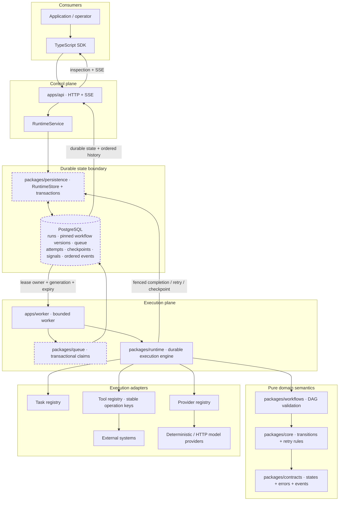

# AgentForge

**AgentForge is a durable TypeScript execution runtime for long-running AI agents and workflows.**

Define a workflow, start a run, survive failures, resume safely, inspect every transition, and keep external side effects behind explicit idempotency boundaries.

AgentForge is a portfolio-grade backend engineering system focused on execution semantics: durable PostgreSQL state, workflow/DAG scheduling, bounded workers, lease generations and stale-worker fencing, retries, cancellation, checkpoints, signals, tools, deterministic model providers, ordered execution history, an HTTP/SSE control plane, and a TypeScript SDK.

It is **not** an n8n clone, a visual workflow builder, a chat UI, a prompt-wrapper library, a generic message broker, an exactly-once marketing claim, or a runtime tied to one LLM vendor.

## Architecture



PostgreSQL is both the durable source of truth and the queue substrate; Redis is intentionally absent in V1. Claims use transactional row locking and lease generations. A worker may execute at least once over time, but only the current lease generation may commit an authoritative result.

## Reliability semantics

- **At-least-once execution reality.** Retries and crash recovery can repeat execution attempts.
- **No arbitrary exactly-once external-effect claim.** A side-effecting tool receives a stable operation key and AgentForge durably records invocation state. An external system must honor an idempotency key if the effect itself must be deduplicated across the crash boundary.
- **Stale-worker fencing.** Lease owner + lease generation + unexpired lease form the commit authority. A completion from an expired generation is rejected.
- **Attempt history is append-only.** Retries create new durable attempts; earlier failures remain inspectable.
- **Workflow version pinning.** A run keeps the exact workflow version it started with.
- **Monotonic cancellation.** Cancellation revokes future ordinary work and prevents stale success from resurrecting a cancelled run.
- **Durable wait/signal.** A run may enter `WAITING`, survive process replacement, accept a named deduplicated signal, and resume downstream scheduling.
- **Idempotent run submission.** `POST /v1/runs` accepts `Idempotency-Key`; same-key/same-request replay returns the original run, while conflicting reuse fails closed.

See [execution model](docs/execution-model.md), [failure semantics](docs/failure-semantics.md), [state machines](docs/state-machines.md), and [idempotency](docs/idempotency.md).

## 5-minute local start

Prerequisites: Node.js 22, Corepack/pnpm 10.18.3, TypeScript 5.8.3 (`tsc` on `PATH`), Docker/Compose, and the PostgreSQL client (`psql`). No AI/provider API key is required.

```bash
corepack enable
corepack prepare pnpm@10.18.3 --activate
npm install --global typescript@5.8.3
pnpm install --frozen-lockfile
pnpm dev:infra
pnpm db:migrate
pnpm dev
```

`pnpm dev` uses `http://127.0.0.1:8787` unless `AGENTFORGE_API_PORT` is set. Compose also publishes port `8787`. When running `pnpm dev:api` directly without environment configuration, use the API process's built-in fallback or export the values from `.env.example` explicitly.

Health surfaces:

```text
GET /health/live   process liveness only
GET /health/ready  PostgreSQL-backed readiness
GET /metrics       Prometheus text metrics
GET /openapi.json  source-controlled runtime contract
```

## SDK example

The `hello-workflow` example starts an actual local HTTP server and uses the public SDK—not raw HTTP—to submit and inspect a three-step workflow:

```ts
import { AgentForgeClient, defineWorkflow } from '@agentforge/sdk';

const client = new AgentForgeClient({ baseUrl: 'http://127.0.0.1:8787' });
const workflow = await client.createWorkflow(defineWorkflow({
  name: 'hello',
  steps: [
    { id: 'a', kind: 'task', handler: 'echo' },
    { id: 'b', kind: 'task', handler: 'echo', dependsOn: ['a'] },
    { id: 'c', kind: 'task', handler: 'echo', dependsOn: ['b'] },
  ],
}));
const run = await client.startRun(workflow.id, { hello: 'world' });
console.log(await client.getRun(run.id));
```

Run it with `pnpm example:hello`.

## Failure-recovery demonstrations

`pnpm example:recovery` deterministically demonstrates lease-expiry recovery and stale-generation fencing. The PostgreSQL integration suite goes further: it launches a worker in a real child process, kills it with `SIGKILL` during an active attempt, starts a replacement worker after lease expiry, and verifies lost-attempt history plus successful recovery.

`pnpm example:agent` demonstrates a deterministic tool-using agent whose first provider attempt fails transiently and is recovered by the runtime retry mechanism.

## Monorepo map

```text
apps/api             HTTP/SSE control plane
apps/worker          durable worker process
packages/contracts   domain types, states, errors
packages/core        transition + retry rules
packages/workflows   workflow validation/DAG semantics
packages/runtime     worker/execution/agent engine
packages/queue       lease/claim SQL contracts
packages/persistence PostgreSQL adapter, durable tool definitions + migrations
packages/events      typed event utilities + EventSource/EventSink boundary
packages/tools       typed tool registry/idempotency policy
packages/providers   deterministic + optional HTTP provider adapter
packages/sdk         validated workflow/client + embedded tool-registry helpers
packages/testing     deterministic clock/random/store test oracle
examples/            executable hello/agent/recovery demonstrations
integration/         real PostgreSQL concurrency/restart/process-kill tests
benchmarks/runtime   internal reproducible benchmark harness
docs/                architecture, semantics, operations, security, ADRs
```

## Verification

```bash
pnpm format:check
pnpm lint
pnpm typecheck
pnpm test:unit
DATABASE_URL=postgresql://... pnpm test:integration
pnpm build
pnpm consumer:check
pnpm check:placeholders
pnpm example:hello
pnpm example:agent
pnpm example:recovery
pnpm benchmark:smoke
```

GitHub Actions repeats the critical gates with PostgreSQL 17 and also validates Compose/fresh PostgreSQL startup and the container build. A workflow file existing is not treated as CI evidence; the R7 evidence ledger records actual observed runs separately.

## Limitations / non-goals

V1 intentionally does not provide a visual workflow designer, n8n compatibility, Kubernetes operators, enterprise SSO, billing, a marketplace, browser automation, RAG/vector storage, multi-region consensus, a production secrets manager, a generic distributed broker, tool sandboxing, or hundreds of integrations. Registered local tools execute with the privileges of their worker process.

The reference API trust boundary is local/private deployment. Input is validated and bounded, SQL is parameterized, obvious secrets are not embedded, and error responses omit stacks, but V1 does not include an internet-facing identity/authentication layer.

The `EventSink` extension point does not by itself claim durable cross-service delivery. A future asynchronous external-delivery adapter must add a transactional outbox or equivalent durable consistency boundary before making crash-safe delivery claims.

## Portfolio relationship

- **Workflows-N8N**: workflow authoring, automation and integration design.
- **RelayForge**: reliable message/webhook/event delivery concerns.
- **AgentForge**: durable execution semantics—state, workers, leases, recovery, retries, cancellation, checkpoints and agents/tools.

These are conceptual portfolio boundaries only. AgentForge has no runtime dependency on the other repositories.

## License

AgentForge is distributed under the proprietary license in `LICENSE`. Public source visibility permits only the rights stated in that license and does not make the project open source. See `LICENSE` and `docs/license-status.md` for the repository's current licensing status.
