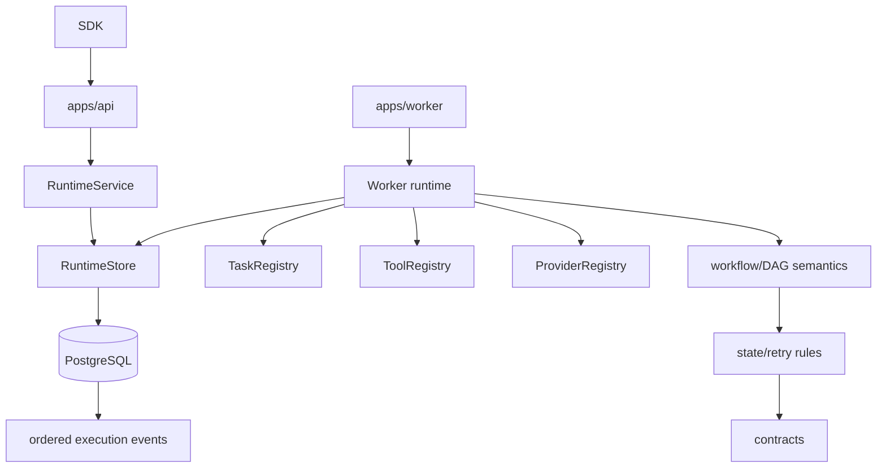
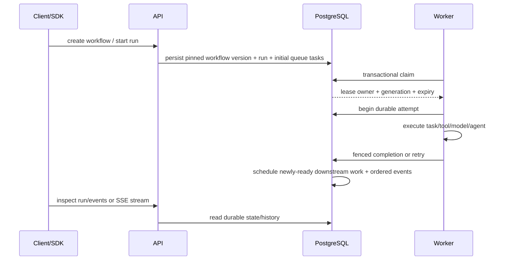

# Architecture

AgentForge separates durable domain semantics from transport and persistence adapters. `contracts`, `core`, and `workflows` contain no HTTP or PostgreSQL dependencies. The runtime consumes abstract `RuntimeStore`, tool, task, and provider contracts. PostgreSQL is the reference adapter; the deterministic in-memory store is an independent test oracle.

## Ownership

- `packages/contracts`: serializable domain entities, IDs, states, events, error taxonomy.
- `packages/core`: pure state-transition and retry policy logic.
- `packages/workflows`: workflow JSON validation, DAG construction, dependency checks, input references.
- `packages/runtime`: application services, worker execution, retries, timeouts, cancellation propagation, checkpoints, tool/model/agent dispatch.
- `packages/queue`: PostgreSQL lease/claim SQL contract and lease configuration checks.
- `packages/persistence`: PostgreSQL adapter, migrations and transaction boundaries.
- `packages/events`: typed event helpers only.
- `packages/tools`: registered-code tool contracts and side-effect/idempotency policy.
- `packages/providers`: model provider abstraction and deterministic/optional HTTP adapters.
- `packages/sdk`: HTTP/SSE consumer ergonomics.
- `apps/api`: control-plane transport; it delegates to runtime/store surfaces.
- `apps/worker`: production-style worker process wiring.

## Forbidden coupling

Domain packages do not import `node:http`, PostgreSQL CLI adapters, or provider-specific SDKs. API routes do not update database rows directly. Examples use exported surfaces. Persistence code owns storage mechanics but does not redefine workflow-state semantics.

## Control flow

## Portfolio boundary

AgentForge may later emit to a reliable delivery sink such as RelayForge, but V1 has no hard dependency. It also does not reproduce n8n-style authoring UI or integration catalogs.
