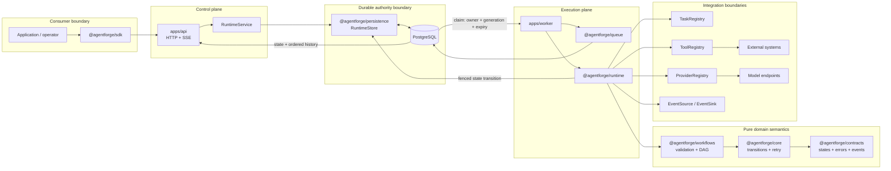
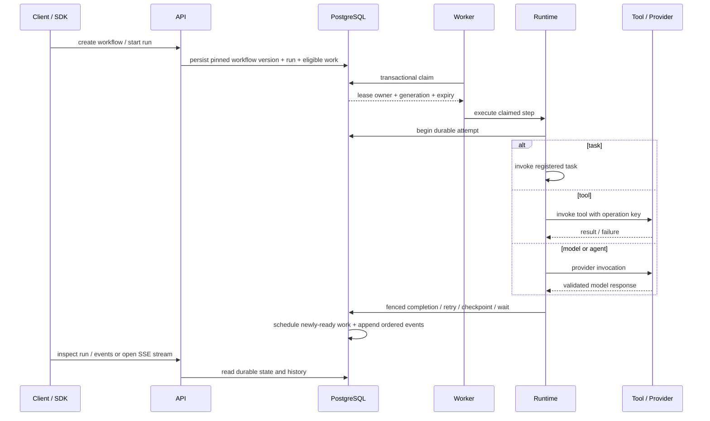

# Architecture

AgentForge separates domain semantics, execution, transport and persistence so reliability rules have a single authority and adapters cannot redefine them.

`packages/contracts`, `packages/core` and `packages/workflows` contain the pure execution model. `packages/runtime` orchestrates those semantics through abstract stores, task/tool registries and provider interfaces. PostgreSQL is the reference durable adapter; the in-memory store in `packages/testing` is an independent deterministic test oracle.

## System view

## Package ownership

- `packages/contracts` owns serializable domain entities, identifiers, states, events and error taxonomy.
- `packages/core` owns legal state transitions and retry-policy rules.
- `packages/workflows` owns workflow validation, DAG construction, dependency checks and input references.
- `packages/runtime` owns application services and worker execution: retries, timeouts, cancellation, checkpoints, signals, tools, providers and agent loops.
- `packages/queue` owns claim/lease SQL contracts and lease configuration validation.
- `packages/persistence` owns PostgreSQL storage mechanics, migrations and transaction boundaries.
- `packages/events` owns typed event source/sink interfaces and bounded event pumping.
- `packages/tools` owns registered-tool contracts and side-effect/idempotency policy.
- `packages/providers` owns model-provider interfaces plus deterministic and optional HTTP adapters.
- `packages/sdk` owns consumer-facing HTTP/SSE ergonomics and workflow helpers.
- `apps/api` owns the control-plane transport and delegates to runtime/store surfaces.
- `apps/worker` owns production-style worker-process wiring.

## Authority boundaries

### Workflow authority

Workflow structure is validated before execution. A run references a pinned workflow version, so later edits do not redefine already-started execution.

### Claim authority

PostgreSQL is the queue and durable source of truth. A claim produces a lease owner, lease generation and expiry. Only the currently authoritative, unexpired generation may commit success, failure, retry or checkpoint state.

### Runtime authority

The runtime interprets domain semantics; adapters cannot invent alternate state transitions. API routes do not update execution rows directly.

### Tool authority

Tools are registered host code. The runtime controls which tool name may execute and supplies a stable operation key for side-effecting operations. The external system remains responsible for honoring an idempotency key when duplicate external effects must be prevented across crashes.

### Provider authority

`ModelProvider.invoke` is the only model-runtime dependency. Provider output is validated before it becomes runtime state. The deterministic provider allows model-independent verification.

### Event authority

Ordered execution history is durable in PostgreSQL. `EventSource` / `EventSink` provide a separate integration boundary; an event sink is not implicitly a durable cross-service transport. See `event-delivery.md`.

## Execution flow

## Failure and recovery

Workers may crash after claiming or even after an external side effect. Recovery therefore assumes execution can recur. Expired leases may be reclaimed with a new generation; stale generations cannot commit. Attempts remain append-only so recovery does not erase prior failure evidence.

Cancellation is monotonic: once cancellation becomes authoritative, stale success cannot restore ordinary execution. Waiting and signals are durable, so process replacement does not erase suspended state.

See `failure-semantics.md`, `idempotency.md`, `checkpoints.md`, `worker-lifecycle.md` and `persistence.md`.

## Safety and governance boundaries

The reference deployment treats workflow/API payloads as untrusted data but registered task/tool implementations as trusted host code. Tool execution is not sandboxed. The API does not include a public-internet identity layer and should run behind an appropriate trusted/authenticated deployment boundary.

Database credentials and provider tokens are environment configuration. Error responses are structured and do not expose stacks by default. SQL state changes remain inside the persistence boundary.

See `security-model.md`, `configuration.md`, `operations.md` and `roadmap.md`.

## Forbidden coupling

- Domain packages do not import HTTP transports, PostgreSQL CLI adapters or provider-specific SDKs.
- API routes do not mutate database execution rows directly.
- Persistence owns storage mechanics but does not redefine workflow-state semantics.
- Examples exercise exported/public surfaces rather than private shortcuts.
- Optional event sinks do not redefine the durable event history maintained by AgentForge.
