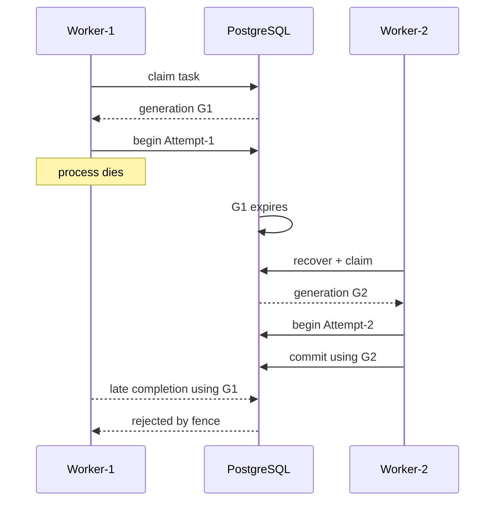

# Execution model

A run is bound to one immutable `WorkflowVersion`. Creating a run persists the run, all logical `StepRun` rows, initial root queue tasks, and ordered events before a worker is involved.

## Scheduling

A step becomes runnable only when every declared predecessor is `SUCCEEDED`. Fan-out produces multiple independent ready tasks. A fan-in step remains `PENDING` until all required branches complete. Cycles and missing dependencies are rejected before the run starts.

## Claim and attempt

A worker claims bounded work from PostgreSQL with row locking and `SKIP LOCKED`. A successful claim writes a worker id, lease expiry and monotonically increasing lease generation. Beginning work creates a distinct durable `Attempt`; retry never overwrites an earlier attempt.

Authority is not based on worker identity alone. The queue row must still be `LEASED` by that worker, with the same generation and an unexpired lease; the corresponding attempt must also match the generation and remain running.

## Retry

The step retry policy bounds attempts, initial delay, multiplier, maximum delay, optional deterministic jitter and optionally eligible error codes. A failed attempt is finalized before a retry is scheduled. Jitter is capped by `maxDelayMs` after application.

## Timeout and cancellation

A step timeout aborts its internal `AbortSignal` and is recorded as `TIMEOUT`, distinct from user cancellation. A workflow cancellation request is persisted, ordinary future work is invalidated, and currently authoritative work loses commit authority. A handler that ignores abort may continue computing in-process, but its late completion cannot turn a cancelled run into success.

## Wait / signal

A wait step persists its `WAITING` state and signal name. Its execution attempt is finished before the run waits. A named signal is stored with a dedupe key; accepted delivery completes the waiting step and schedules downstream work transactionally. Repeating the same key is reported as a duplicate. A different late signal after the wait is gone fails closed.

## Completion

A run succeeds only after every logical step is in a successful terminal interpretation (`SUCCEEDED` or intentional `SKIPPED`). Fail-fast failure cancels other unfinished logical work. Terminal run and step states do not transition back to active states.
