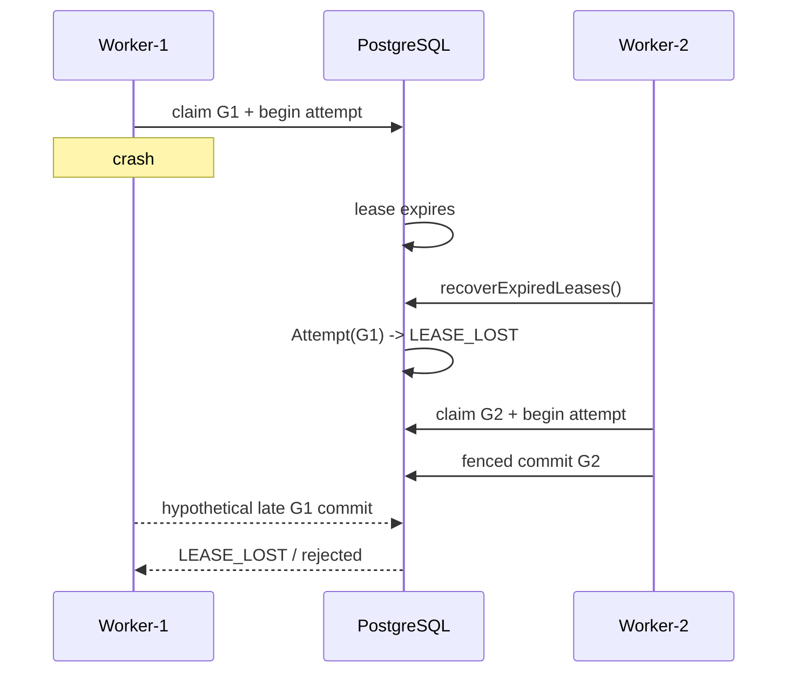

# Failure semantics

Failure and recovery are normal runtime behavior, not exceptional architecture paths.

| Failure | Durable behavior |
|---|---|
| Worker dies after claim | Lease eventually expires; recovery makes the logical task claimable again. |
| Worker dies after beginning an attempt | Attempt remains historical; recovery marks the expired running attempt `LEASE_LOST`. |
| Worker completes after losing lease | Commit is rejected by lease owner/generation/expiry and attempt-generation fencing. |
| Step throws retryable error | Attempt is finalized, retry policy is evaluated, and a scheduled retry creates a later attempt. |
| Retry budget exhausted | Step and run fail terminally under V1 fail-fast semantics. |
| Step times out | Abort is requested; attempt records `TIMED_OUT`; timeout remains distinguishable from user cancellation. |
| Run is cancelled | Cancellation is persisted, queued/active ordinary work loses authority, pending downstream work is not scheduled, and run becomes `CANCELLED`. |
| Handler ignores cancellation | It may continue CPU/application work locally, but stale completion cannot commit after authority is revoked. |
| PostgreSQL unavailable | Readiness becomes false and persistence-dependent operations fail; liveness can remain true. |
| API process restarts | Authoritative run/step/queue/event state remains in PostgreSQL. |
| Duplicate task observation | Authoritative lease generation and logical step state prevent duplicate logical completion. |
| Duplicate signal | Same run/name/dedupe key returns `duplicate`; a distinct late signal fails closed. |
| Malformed provider output | Provider validation raises an explicit non-success error. |
| Oversized payload/checkpoint/tool output | Request/execution fails against configured bounds. |

## Side-effect crash boundary

A particularly important failure occurs when an external side effect succeeds but the worker dies before the step result is finalized.

AgentForge records side-effecting tool invocations using `(tool_name, operation_key)` and reuses a durable completed invocation record on a later attempt. This prevents AgentForge itself from intentionally invoking the registered tool handler a second time after it knows the first invocation completed.

This is **not** a universal exactly-once guarantee. There is still an unavoidable uncertainty window if the external system accepts an effect but AgentForge cannot durably record the result. To close that window, the external API must itself honor the stable idempotency/operation key. See `docs/idempotency.md`.

## Lease recovery sequence

The executable `failure-recovery` example and both deterministic and PostgreSQL integration tests cover this path.
