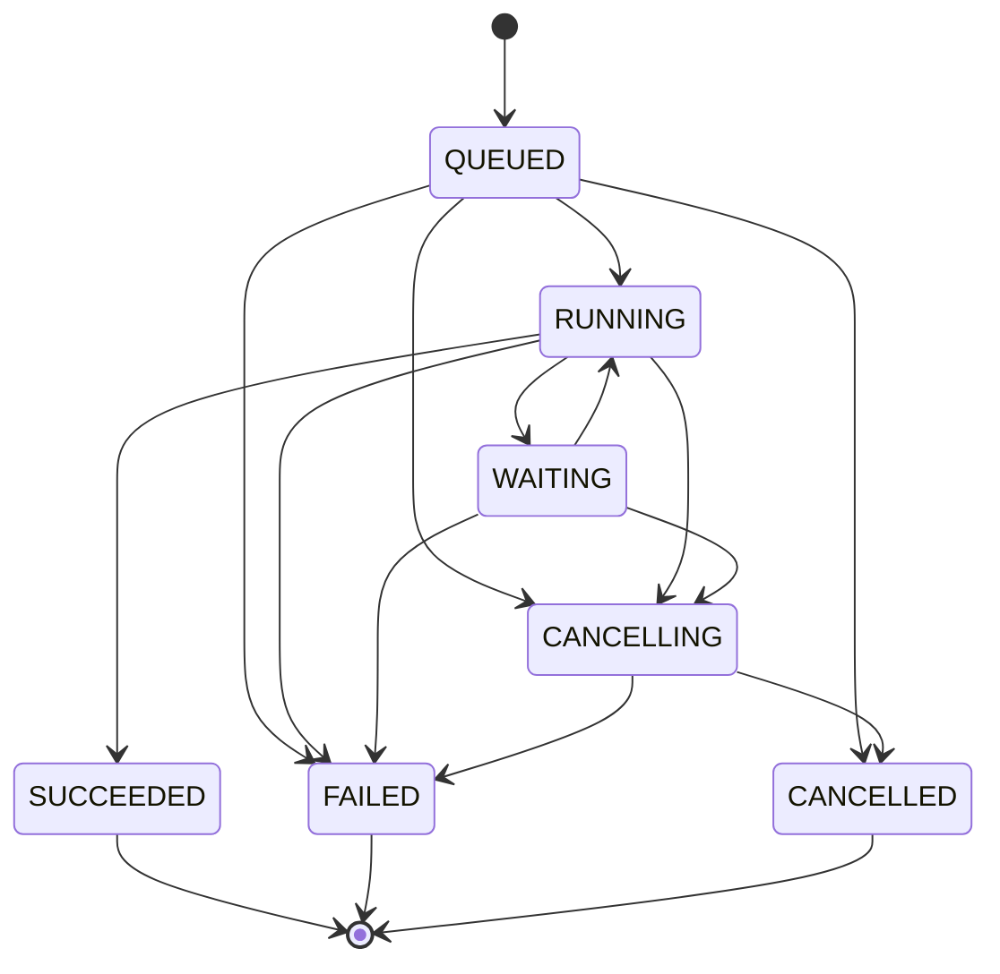
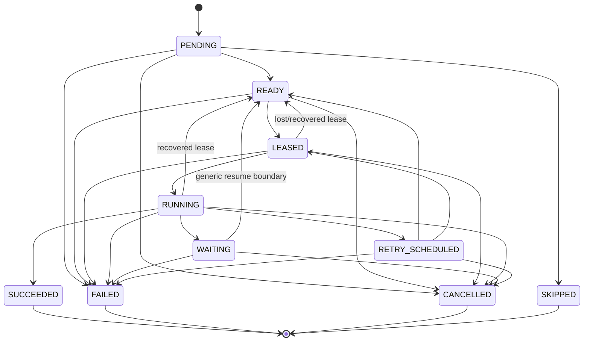

# State machines

Illegal transitions fail closed in `packages/core`; terminal states have no outgoing ordinary transitions.

## WorkflowRun

Terminal: `SUCCEEDED`, `FAILED`, `CANCELLED`.

## StepRun

For the implemented signal path, accepted signal delivery moves the waiting logical step directly to `SUCCEEDED`, returns the workflow run to `RUNNING`, and schedules dependents. The `WAITING -> READY` transition remains available to recovery semantics but is not used to re-execute a signal-wait instruction.

## Attempt

Attempts are immutable historical executions except for their one-way completion from `RUNNING` to `SUCCEEDED`, `FAILED`, `TIMED_OUT`, `CANCELLED`, or `LEASE_LOST`. A retry allocates another attempt identity; it does not reuse or overwrite the old one.
